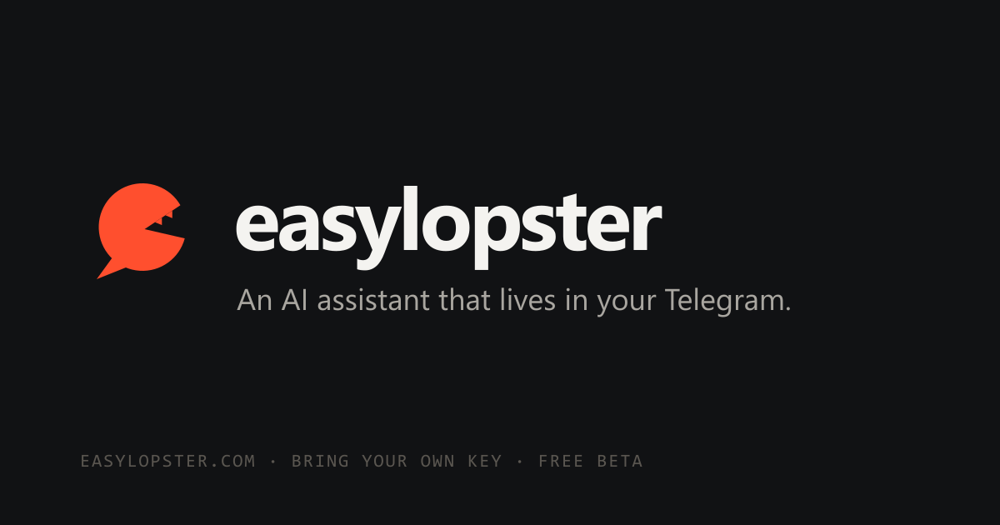

<p align="center">
  <a href="https://easylopster.com"></a>
</p>

<h1 align="center">easylopster</h1>

<p align="center">
  An AI assistant that lives in your Telegram. Hosted, nothing to install, free during the beta.<br>
  <a href="https://easylopster.com"><b>easylopster.com</b></a> · <a href="CHANGELOG.md">Changelog</a> · <a href="https://github.com/noneym/easylopster.com/releases">Releases</a> · <a href="mailto:hello@easylopster.com">hello@easylopster.com</a>
</p>

---

**Create your assistant for free at [easylopster.com](https://easylopster.com):** sign up, paste an LLM API key
(Anthropic, OpenAI, Gemini, OpenRouter, DeepSeek or any OpenAI-compatible endpoint), paste a Telegram bot
token from BotFather, and talk to it. The bot interviews you on first contact and writes its own
personality and memory files. Add MCP servers, store secrets, schedule automations, and connect your own
computer as a *node* (Windows tray app, `npx easylopster-node`, or a Docker image) when you need local
files or a shell.

Inspired by [OpenClaw](https://github.com/openclaw/openclaw): the same workspace files, bootstrap interview,
pairing flow and Telegram behaviours, reimplemented as a multi-tenant web service.

## What you get

- **Bots** – several Telegram bots per account, each with its own model, persona (SOUL.md), access policy and tools; a web chat for every bot.
- **Onboarding by conversation** – BOOTSTRAP.md on first run; the bot asks who you are and how it should behave, then writes IDENTITY/SOUL/USER/MEMORY.md itself.
- **Setup by chat** – add MCP servers, pair nodes, store secrets, switch models and import skills by asking the bot.
- **Memory** – daily notes, MEMORY.md, hybrid keyword + embedding search, nightly "dreaming" that promotes durable facts.
- **Automations** – cron / interval / one-shot wakeups, a one-click heartbeat, standing intents, single-level subagents.
- **Tools** – workspace files, web search and fetch, skills (SKILL.md), secrets injected as env vars, optional Linux sandbox, your own machines as nodes with approvals in chat.
- **MCP** – remote servers over Streamable HTTP or SSE, tool discovery, per-bot tool selection.
- **Telegram parity** – pairing codes, streaming drafts, media in and out, voice transcription, group mention gating, session resets, `/new /status /model /think /usage /compact …`.

See [PLAN.md](PLAN.md) for architecture, data model and the OpenClaw parity list.

## Layout

```
apps/web             Next.js 16 (SSR landing, auth, dashboard, Telegram webhook receiver, web chat)
apps/gateway         Node worker: agent loop (AI SDK), Telegram, MCP clients, node WebSocket server, schedulers
packages/db          Prisma 7 schema + client (MariaDB via @prisma/adapter-mariadb)
packages/shared      zod schemas, crypto, provider registry, node protocol, version
packages/node-agent  CLI + library that connects a machine to your account (also the Docker image)
packages/node-desktop Windows tray app (Electron) around the node agent
docker/              web.Dockerfile, gateway.Dockerfile, node-agent.Dockerfile
docs/openclaw-notes  Behaviour notes distilled from the OpenClaw source
scripts/             set-version, gen-icons (brand assets)
```

## Development

```bash
pnpm install
cp .env.example .env        # fill DATABASE_URL, REDIS_URL, ENCRYPTION_KEY, INTERNAL_SECRET
pnpm db:generate
pnpm --filter @easylopster/db deploy
pnpm dev                     # web :3000 + gateway :GATEWAY_PORT
```

Schema changes: edit `packages/db/prisma/schema.prisma`, then

```bash
pnpm --filter @easylopster/db migrate:new <name>   # diffs the live DB against the schema (no shadow DB needed)
pnpm --filter @easylopster/db deploy
```

Releases: `pnpm version:set x.y.z`, update `CHANGELOG.md`, tag `vx.y.z`. The release workflow publishes the
GitHub Release, the node agent bundle, the `ghcr.io/noneym/easylopster-node` image and the Windows installer.

## Deploy

Production runs on [dockxo.com](https://dockxo.com) as two services built from this repository:
`docker/web.Dockerfile` (port 3000, easylopster.com) and `docker/gateway.Dockerfile` (port 4000,
gw.easylopster.com, WebSocket for nodes, volume at `/data/workspaces`). Both read the same `DATABASE_URL`,
`REDIS_URL`, `ENCRYPTION_KEY`, `INTERNAL_SECRET`; mail goes through Cloudflare Email Service
(`MAIL_MAILER=cloudflare`). Redis must run with `maxmemory-policy noeviction` (BullMQ requirement).
Any Docker host with MariaDB and Redis works the same way.

## Contact

Questions, bugs, ideas: [hello@easylopster.com](mailto:hello@easylopster.com) or open an issue.
